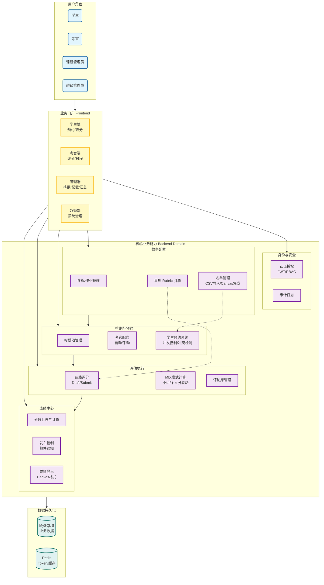

# OAS（Oral Assessment System）— Web 口语评估平台

面向高校口语考试/口试场景的一体化平台：**管理员配置与排期 → 学生预约 → 考官评分与反馈 → 成绩汇总与发布 → Canvas CSV 导入导出**。



## 这是什么？

OAS 是一个以 **角色为中心（RBAC）** 的口语评估系统，覆盖口试全生命周期。
- **课程管理员（Course Admin）**：课程/作业配置、场次生成与配岗、CSV 导入导出、成绩汇总与发布
- **学生（Student）**：查看可用场次、预约/改约、查看已发布成绩与反馈
- **考官（Examiner）**：查看分配场次、评分（草稿/提交）、使用评论模板/量规
- **超级管理员（Super Admin）**：系统级课程与管理员权限管理（视实现范围）

需求与边界以 [Docs/Requirement/Project Scope.md](Docs/Requirement/Project%20Scope.md) 与 [Docs/Requirement/user_stories.md](Docs/Requirement/user_stories.md) 为准。

## 快速开始（本地开发）

> 说明：仓库是 monorepo，包含 [frontend/](frontend/) 与 [backend/](backend/)。

### 1) 启动 MySQL 8 并初始化数据

仓库已提供建表与测试数据脚本：
- `backend/src/main/resources/db/DDL.sql`
- `backend/src/main/resources/db/test_data.sql`

使用 Docker（示例）：

```bash
docker run -d --name mysql8 \
  -e MYSQL_ROOT_PASSWORD=swen90017_ps \
  -e MYSQL_DATABASE=swen90017_db \
  -p 3306:3306 \
  mysql:8
```

导入脚本（示例）：

```bash
# 进入容器
docker exec -it mysql8 bash

# 在容器内执行：
mysql -uroot -pswen90017_ps swen90017_db < /path/to/DDL.sql
mysql -uroot -pswen90017_ps swen90017_db < /path/to/test_data.sql
```

> 你也可以用本机 MySQL 客户端导入上述 SQL 文件（推荐）。

### 2) 启动后端（Spring Boot）

后端默认端口：`8081`（见 `backend/src/main/resources/application.yml`）。

必要环境变量（最小集合）：
- `JWT_SECRET`
- `DB_USERNAME`、`DB_PASSWORD`

建议通过环境变量覆盖数据源（避免改代码）：

```powershell
cd backend

$env:SPRING_DATASOURCE_URL="jdbc:mysql://localhost:3306/swen90017_db?allowPublicKeyRetrieval=true&useSSL=false&serverTimezone=UTC"
$env:DB_USERNAME="root"
$env:DB_PASSWORD="swen90017_ps"
$env:JWT_SECRET="dev-only-change-me"

.\mvnw.cmd spring-boot:run
```

后端 API：
- 基础地址：`http://localhost:8081`
- Swagger / OpenAPI：`/swagger-ui/index.html`（也可能兼容 `/swagger-ui.html`）
- OpenAPI JSON：`/v3/api-docs`

### 3) 启动前端（Next.js）

```powershell
cd frontend
npm install

# 指向后端（推荐）
$env:NEXT_PUBLIC_API_BASE_URL="http://localhost:8081"

npm run dev
```

前端地址：`http://localhost:3000`

### 4) 测试账号（来自后端测试数据）

这些账号来自 `backend/src/main/resources/db/test_data.sql`（密码在前端 README 有列示）。
- Course Admin: `alice@student.unimelb.edu.au`
- Student: `bob@student.unimelb.edu.au`
- Examiner: `eve@student.unimelb.edu.au`

更完整的账号表与前端运行说明见 [frontend/README.md](frontend/README.md)。

## API 入口与路径约定（以代码为准）

后端存在两类路径：
- **认证/注册类**：`/login`、`/logout`、`/register`、`/token/refresh`、`/auth/password-reset/**`
- **业务 API**：多数以 `/api/...` 开头（例如 `/api/courses`、`/api/assignments`、`/api/csv`）

如果你在联调时出现 404，优先去 Swagger 查实际路径。

## 配置与环境变量（常用）

后端（`backend/src/main/resources/application.yml`）：
- `DB_USERNAME` / `DB_PASSWORD`
- `JWT_SECRET`
- `MAIL_USERNAME` / `MAIL_PASSWORD`（密码重置邮件）
- `EMAIL_DOMAIN_VALIDATION_ENABLED`（邮箱后缀校验开关）
- `CSV_STORAGE_PATH`、`CSV_IMPORT_USE_EMAIL_COLUMN`
- `CORS_ALLOWED_ORIGINS` / `CORS_ALLOW_CREDENTIALS` 等
- `REDIS_URL`（默认指向 Render 的托管 Redis，可覆盖为本地/自建）

前端：
- `NEXT_PUBLIC_API_BASE_URL`（Axios baseURL；缺省为 `/api`）

> 注意：`frontend/docker-compose.yml` 当前把 `NEXT_PUBLIC_API_BASE_URL` 设成 `http://localhost:3000/api`，更偏向“前端自带 mock/legacy API routes”的模式；若你要连真实后端，请改为 `http://<backend-host>:8081`。

## 文档导航（把这里当作“项目门户”）

### 1) 一口气理解系统（推荐从这里开始）
- 知识库总览（架构/权限/RBAC）：[Docs/RAG-KB/01-系统总览与权限模型.md](Docs/RAG-KB/01-%E7%B3%BB%E7%BB%9F%E6%80%BB%E8%A7%88%E4%B8%8E%E6%9D%83%E9%99%90%E6%A8%A1%E5%9E%8B.md)
- 学生预约与场次：[Docs/RAG-KB/02-学生预约与场次管理.md](Docs/RAG-KB/02-%E5%AD%A6%E7%94%9F%E9%A2%84%E7%BA%A6%E4%B8%8E%E5%9C%BA%E6%AC%A1%E7%AE%A1%E7%90%86.md)
- 评分/MIX/汇总：[Docs/RAG-KB/03-评分与MIX模式与汇总.md](Docs/RAG-KB/03-%E8%AF%84%E5%88%86%E4%B8%8EMIX%E6%A8%A1%E5%BC%8F%E4%B8%8E%E6%B1%87%E6%80%BB.md)
- CSV 集成：[Docs/RAG-KB/04-CSV导入导出集成.md](Docs/RAG-KB/04-CSV%E5%AF%BC%E5%85%A5%E5%AF%BC%E5%87%BA%E9%9B%86%E6%88%90.md)

### 2) 需求与范围
- 范围声明：[Docs/Requirement/Project Scope.md](Docs/Requirement/Project%20Scope.md)
- User Stories（按 Epic）：[Docs/Requirement/user_stories.md](Docs/Requirement/user_stories.md)

### 3) API 合同与设计文档
- API 合同集合： [Docs/API/](Docs/API/)
- 设计/用户流： [Docs/Design/](Docs/Design/)

### 4) 后端专属文档
- 后端 API 文档（概要）：[backend/Docs/Backend_API_Documentation.md](backend/Docs/Backend_API_Documentation.md)
- 部署：
  - [backend/Docs/Deployment_Doc.md](backend/Docs/Deployment_Doc.md)
  - [backend/Docs/Deployment-Guide.md](backend/Docs/Deployment-Guide.md)

### 5) 架构图与数据库图
- 架构说明：[Docs/Architecture/README.md](Docs/Architecture/README.md)

## 仓库结构

```
OAS-web-based-oral-assessments/
  frontend/    # Next.js 15 + React 19 + Tailwind
  backend/     # Spring Boot 2.7 + Java 8 + MyBatis-Plus
  Docs/        # 需求 / 设计 / API / 架构 / 会议纪要 / 测试
  logs/
```

## 技术栈（以代码为准）

- 前端：Next.js 15、React 19、Tailwind CSS、Zustand、TanStack Query、Axios
- 后端：Spring Boot 2.7.5、Spring Security、JWT（Access/Refresh）、MyBatis-Plus、Springdoc OpenAPI
- 数据：MySQL 8
- 基础设施：Redis（可选）、SMTP/SendGrid（邮件）、Microsoft Graph（Calendar，按实现启用）

---

## 团队成员

### Product Team

<table>

  <tr>
    <td width="150" align="center">
      <a href="https://github.com/yungenc">
        
      </a>
    </td>
    <td>
      <h3>Product Owner</h3>
      <p><b>Ian Chi</b> (Student ID: 1579898)</p>
      <p>Stakeholder Communication, Feature Prioritization, User Story Mapping</p>
      <p><a href="https://github.com/yungenc">@yungenc</a></p>
    </td>
  </tr>

</table>

### Arch & DevOps Team

<table>
  <tr>
    <td width="150" align="center">
      <a href="https://github.com/lihaocheng1006">
        
      </a>
    </td>
    <td>
      <h3>Scrum Master, Frontend Lead</h3>
      <p><b>Haocheng Li</b> (Student ID: 1525380)</p>
      <p>Experienced in Agile methodologies and team coordination. Proficient in managing sprints, facilitating ceremonies, and ensuring smooth development workflow. Skilled in technical leadership and cross-team collaboration.</p>
      <p><a href="https://github.com/lihaocheng1006">@lihaocheng1006</a></p>
    </td>
  </tr>

  <tr>
    <td width="150" align="center">
      <a href="https://github.com/xiongnemo">
        
      </a>
    </td>
    <td>
      <h3>DevOps & Backend Lead (from 2nd May) & Frontend Developer (for Semester 2)</h3>
      <p><b>Yunpeng Xiong</b> (Student ID: 1513076)</p>
      <p>Component Development, State Management</p>
      <p><a href="https://github.com/xiongnemo">@xiongnemo</a></p>
    </td>
  </tr>
</table>

### Backend Dev Team

<table>
  <tr>
    <td width="150" align="center">
      <a href="https://github.com/username">
        
      </a>
    </td>
    <td>
      <h3>Backend Developer</h3>
      <p><b>Dongqiao He</b> (Student ID: 1373829)</p>
      <p>Good at Java Backend</p>
      <p><a href="https://github.com/username">@DongqioaHe</a></p>
    </td>
  </tr>
  <tr>
    <td width="150" align="center">
      <a href="https://github.com/LiWinston">
        
      </a>
    </td>
    <td>
      <h3>Backend Developer</h3>
      <p><b>Yongchun Li</b> (Student ID: 1378156)</p>
      <p>Experienced in developing web backends with Spring Boot and deploying Docker containers on Render. Looking forward to enhancing skills in complex database operations, business logic decoupling, and microservices architecture through this project.</p>
      <p><a href="https://github.com/LiWinston">@LiWinston</a></p>
    </td>
  </tr>
  <tr>
    <td width="150" align="center">
      <a href="https://github.com/Crystallen1">
         
      </a>
    </td>
    <td>
      <h3>Backend Developer</h3>
      <p><b>Yun Chen</b> (Student ID: 1412174)</p>
      <p>Familiar with enterprise-level development in Spring Boot, understanding part of backend infrastructure design, and knowledgeable about Docker and Kubernetes. Looking to enhance backend infrastructure development skills, particularly in security and authentication.</p>
      <p><a href="https://github.com/Crystallen1">@Crystallen1</a></p>
    </td>
  </tr>
  <tr>
    <td width="150" align="center">
      <a href="https://github.com/wangxiang13">
        
      </a>
    </td>
    <td>
      <h3>Backend Developer</h3>
      <p><b>Xiang Wang</b> (Student ID: 1373795)</p>
      <p>Familiar with Java and Spring Boot web development, with an understanding of backend architecture and database design. Hope to improve my backend architecture design skills, deepen my technical understanding, and gain more enterprise-level project experience.</p>
      <p><a href="https://github.com/wangxiang13">@wangxiang13</a></p>
    </td>
  </tr>
</table>

### Frontend Dev Team

<table>
  <tr>
    <td width="150" align="center">
      <a href="https://github.com/lihaocheng1006">
        
      </a>
    </td>
    <td>
      <h3>Scrum Master, Frontend Lead</h3>
      <p><b>Haocheng Li</b> (Student ID: 1525380)</p>
      <p>Experienced in React and Next.js development with a strong focus on AI integration. Proficient in building modern web applications and implementing AI-powered features. Looking to enhance frontend development skills and create innovative user experiences.</p>
      <p><a href="https://github.com/lihaocheng1006">@lihaocheng1006</a></p>
    </td>
  </tr>
  <tr>
    <td width="150" align="center">
      <a href="https://github.com/Kruase">
        
      </a>
    </td>
    <td>
      <h3>Frontend Developer</h3>
      <p><b>Yanqing Shi</b> (Student ID: 1511676)</p>
      <p>Familiar with frontend programming, with frontend programming experience in Django, React, Next.js and other frameworks. I hope to further exercise my frontend development ability and improve my UI design level.</p>
      <p><a href="https://github.com/Kruase">@Kruase</a></p>
    </td>
  </tr>
  <tr>
    <td width="150" align="center">
      <a href="https://github.com/YulkonFU">
        
      </a>
    </td>
    <td>
      <h3>Frontend Developer</h3>
      <p><b>Yukun Fu</b> (Student ID: 1538627)</p>
      <p>Familiar with front-end development, have some developing experience with react and vue, hope to improve my front-end development level in this project</p>
      <p><a href="https://github.com/YulkonFU">@YulkonFU</a></p>
    </td>
  </tr>
</table>

## 贡献指南

见 [CONTRIBUTING.md](CONTRIBUTING.md) 与 [CODE_OF_CONDUCT.md](CODE_OF_CONDUCT.md)。
